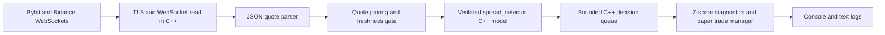
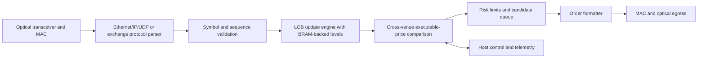

# FPGA performance evidence and mmap plan

> NOTE: Not all features have been implemented yet. This is a rough plan and may change with time. Use this as reference to find out what is obtainable in Verilog/Yosys

## What exists now

The runnable source path is:

The fixed-point quote values use a scale of 10,000. Divide a bid or ask by
10,000 to get its price. `net_profit_o` uses price scale times the 10,000 fee
scale, so divide the signed RTL result by 100,000,000 to get quote-currency
profit per one base unit. These are integers for exact arithmetic, not prices
in dollars as raw integers.

The report generated by `market_data_engine` measures the application path
from the WebSocket message callback through parsing, quote pairing, Verilator
evaluation, and strategy-queue handoff. It reports distributions, not just a
mean. It does not include the network path before the callback, optical
propagation, exchange matching, a physical FPGA clock, or order transmission.

## Performance evidence to collect

| Metric | Current evidence | Evidence needed for a hardware claim |
| --- | --- | --- |
| C++ receive-to-RTL-result | `steady_clock` samples in the runtime report | Keep as host-path latency; record host, compiler, build, load, and sample count |
| Verilator evaluation time | Wall-clock time around generated-model `eval()` calls | FPGA cycle timing from a routed implementation; Verilator time is not an RTL clock period |
| RTL registered latency | One rising-edge cycle in the module/testbench | Clock constraint plus post-route timing report |
| Fiber RX/TX | Not measured | Timestamped packet ingress/egress at calibrated NIC/MAC hardware plus synchronized clocks and route information |
| Fmax, WNS, WHS | Not measured | Target-specific place-and-route timing summary and constraints |
| LUT, FF, carry, BRAM, URAM, DSP | Generic Yosys report only; no device mapping | Vendor synthesis and implementation utilization report for an exact part |
| HIL/DMA | No FPGA device or DMA path configured | Board/driver capture with host and card timestamps, packet sequence numbers, and loss counters |

Do not add fiber distance divided by a nominal propagation constant to host
timings and label the sum measured end-to-end latency. Measure the path at both
ends or label it as a separate propagation estimate with its assumptions.

## FPGA datapath to build

Only the cross-venue spread detector is implemented in RTL today. The current
WebSocket payload is parsed in C++; the RTL has no Ethernet, MAC/PHY, packet
parser, LOB memory, valid/ready backpressure interface, order formatter, or
egress path. Build and verify those blocks as separate stages before claiming
full exchange-to-order hardware latency.

## Verification sequence

1. Keep the directed RTL/reference-model tests for reset, fixed-point limits,
   both directions, fee handling, thresholds, invalid quotes, and consecutive
   transactions.
2. Add a deterministic quote trace fixture and compare every RTL input/output
   against a software golden model. Record trace hash, count, mismatches, and
   dropped sequence numbers.
3. When an AXI-Stream parser exists, add cocotb packet replay for malformed
   packets, crossed books, cancel/update sequences, zero depth, and sustained
   backpressure. Assert ready/valid stability and no deadlock.
4. Run vendor synthesis and place-and-route for a named FPGA part and clock
   constraint. Archive utilization, Fmax, WNS/WHS, tool versions, constraints,
   and the bitstream hash.
5. Run HIL with hardware timestamps on ingress and egress, DMA sequence IDs,
   packet-loss counters, and a software golden model. Separate exchange/network
   latency from host processing and FPGA processing.

## mmap boundary
> This is only necessary if we're trying to export rtl into physical FPGA.

The current Verilated model and strategy run in one executable, so a direct C++
call and the existing queue are simpler and faster than `mmap()`. `mmap()` is
useful at a real boundary:

- For separate host processes, define a versioned SPSC shared-memory ring with
  fixed-width quote/result records, sequence IDs, monotonic producer/consumer
  indices, process-shared atomics, and explicit full-ring behavior. Keep the
  Verilator or hardware adapter as producer and the strategy as consumer.
- For an FPGA, map a driver-owned UIO/VFIO or vendor DMA interface. Use a small
  MMIO register window for control/status and DMA buffers for quote/result
  streams; do not treat a regular file mapping or `/dev/mem` as FPGA access.
- Keep one `RtlBackend` interface so direct Verilator, shared-memory simulation,
  and a board driver can be swapped without changing the strategy.

No board-specific mmap backend is enabled yet because this repository does
not identify an FPGA board, PCIe/AXI interface, kernel driver, or DMA ABI.
