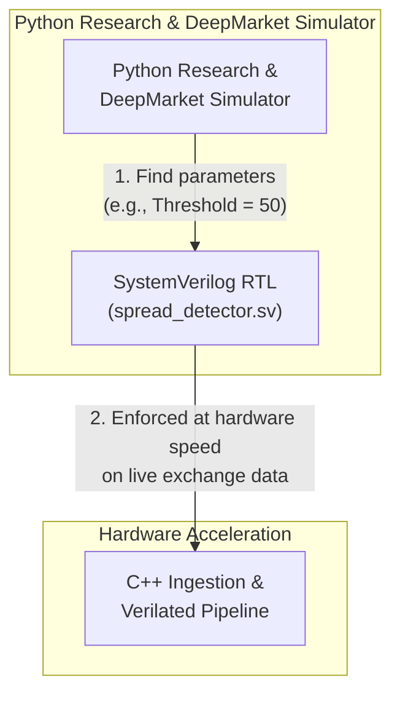
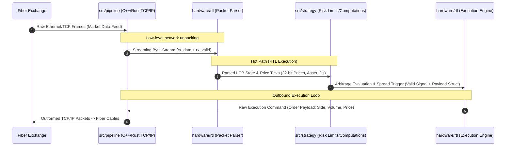

# Market Microstructure Ingestion Engine PoW
Author      : hmzk1422  
Version     : v1.0.0

## Architecture

Flow:  

Explanation for System Architecture:
- **Zero-Copy Ingestion (C++/Rust Network Layer)**: Replaces standard OS socket stacks with kernel-bypass polling (e.g., Solarflare EF_VI / DPDK) to ingest raw line-rate Ethernet frames directly into userspace memory buffers, eliminating context-switch jitter.
- **Deterministic FPGA Offload (SystemVerilog / Xilinx RTL)**: Pips raw order-book parsing and cross-exchange arbitrage threshold detection onto custom hardware. By avoiding CPU branch-misprediction penalties and cache misses, the RTL evaluates spreads in deterministic single-digit
- **Low-Latency Signal Interconnect (Verilated / Memory-Mapped I/O)**: Bridges the hardware detection trigger to the C++ orchestration layer via zero-copy shared memory rings and polled status registers (mmap), shaving microseconds off the standard Linux IPC overhead.
- **Asymmetric Risk & Execution Guardrails (Hot/Cold Split)**: The hot path executes bare-metal order construction upon signal assertion while offloading non-critical logging, telemetry, and TimescaleDB persistence to asynchronous background threads to guarantee zero blocking latency on the trading loop.

## Clearing House (Intermediary)
Explanation for System Architecture
- **Aggregation of Hybird Orderbook Data**: Queries from websocket directly, combines the aggregated liquidity in real markets as well as ABIDES-simulated data. Connects to Adversarial and User side by fiber cables.
- **Executional Friction and Liquidity System**: Manages FIFO queue for orders, slippage, priority orders between MARL agents, etc. Matches orders between MARL agents or real liquidity (Assumption: Liquidity is accurately simulated by using real data but lacks adaptive response from the market. As such, MARL agents handles this).
- **Data Modification**: Price data determined by real market or simulated market prices (Simulated market prices are constructed by synthetic features that explains only a portion of its variation (e.g., 50%)). However, new limit order/market order placements by player and MARL agents will cause drift in market price.

## Adversarial Side
Explanation for System Architecture
- **Toxic Order Flow Generation (Adversarial MARL / Momentum Ignition)**: Simulates predatory market participants and latency arbitrageurs designed to exploit information asymmetry, injecting toxic adverse selection and aggressive flow into the matching engine.
- **Dynamic Quote Stuffing & Spoofing Vectors**: Employs algorithmic agents that flood the limit order book with transient liquidity, phantom cancels, and high-frequency quote updates to stress-test the user's hardware spread detection and risk guardrails under adverse market conditions.
- **Adverse Selection & Queue Position Stress-Testing**: Probes the limits of the User Side's queue priority and fill probability models by simulating aggressive front-running and informed order cancellation cascades during high-volatility regimes.

# End-to-End Arbitrage Pipeline (Windows)

The arbitrage strategy lives in `hardware/sim/sim_main.cpp` (user side, connected to Verilator RTL). It:
1. Connects to the ABIDES LOB simulator via TCP socket (127.0.0.1:6789)
2. Computes a rolling z-score on the spread
3. Feeds `z * 1e8` to Verilator RTL (`Vspread_detector`)
4. Reads `threshold_breached_o` from RTL
5. Opens long/short positions on threshold breach (mean reversion entry)
6. Closes positions when z reverts toward 0 (mean reversion exit)
7. Tracks and reports PnL per symbol

### Prerequisites
- Windows with Visual Studio 2022 (MSVC) and CMake
- Python 3.x with ABIDES simulator

### Step 1: Build the C++ Strategy Binary

```powershell
# From the project root
cd hardware
mkdir build
cmake -S . -B build
cmake --build build --parallel --config Debug
```

Output: `Debug/sim_spread_detector.exe`

### Step 2: Start the ABIDES LOB Simulator

```powershell
# From the project root
cd exchange/abides
python exchange_simulator.py --tcp --port 6789
```

The simulator publishes binary LOB packets (magic header + per-symbol spread/best-bid/best-ask, all scaled by 1e8).

### Step 3: Run the Arbitrage Strategy

```powershell
# From the project root
.\Debug\sim_spread_detector.exe 127.0.0.1 6789
```

Expected output:
```
[STRATEGY] Connected to exchange at 127.0.0.1:6789
[STRATEGY] Z-score threshold: 2 sigma
[STRATEGY] Position size: 1
[STRATEGY] Press Ctrl+C to stop.

[ARB] BTCUSDT LONG  @ z=-2.30 spread=33.58
[ARB] BTCUSDT CLOSE @ z=0.41 PnL=3.78 Total=3.78
[ARB] ETHUSDT SHORT @ z=2.17 spread=37.29
[ARB] ETHUSDT CLOSE @ z=0.34 PnL=3.60 Total=8.20

[STRATEGY] Shutting down... processed 15420 updates.
[STRATEGY] BTCUSDT Total PnL: 5.71
[STRATEGY] ETHUSDT Total PnL: 8.20
```

Press Ctrl+C to stop and print the final PnL summary.

### Architecture Details

| Component | File | Responsibility |
|-----------|------|---------------|
| RTL Spread Detector | `hardware/rtl/spread_detector.sv` | Compares scaled z-score against threshold, asserts `threshold_breached_o` |
| Verilator Mock | `exchange/verilator_hooked.h` | C++ mock of `Vspread_detector` (Verilator not installed on Windows) |
| Socket Reader | `exchange/socket_reader.{h,cpp}` | TCP client for ABIDES simulator (Windows loopback) |
| Arbitrage Strategy | `hardware/sim/sim_main.cpp` | Z-score mean reversion: open on |z|>=2, close on z→0, PnL tracking |
| Terminal Plot | `exchange/terminal_plot.{h,cpp}` | Real-time ANSI sparkline + signal display |

### Configuration (`exchange/config.h`)

- `zscore_threshold = 2.0` — entry threshold (sigma)
- `threshold_scaled = 5000` — RTL fixed-point threshold
- `position_size = 1.0` — base currency per trade
- `price_scale = 1e8` — price/spread scaling factor
# Summary and Results
> NOTE: This system is instrumented for functional verification and architectural demonstration via Verilator in a virtualized WSL environment. Absolute latency metrics reflect software simulation and OS virtualization overhead, not bare-metal hardware performance.
# Citations
```
@article{berti2025trades,
  title={TRADES: Generating Realistic Market Simulations with Diffusion Models},
  author={Berti, Leonardo and Prenkaj, Bardh and Velardi, Paola},
  journal={arXiv preprint arXiv:2502.07071},
  year={2025}
}
```
