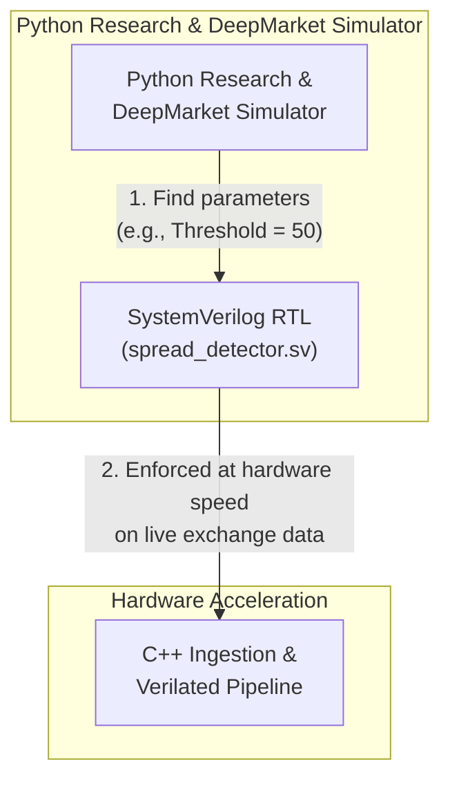
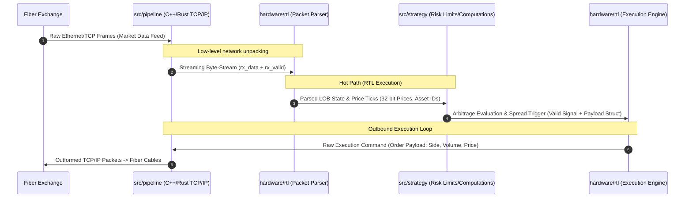

# Market Microstructure Ingestion Engine PoW
Author      : hmzk1422  
Version     : v1.0.0

## Architecture

Flow:  

Explanation for System Architecture:
- **Zero-Copy Ingestion (C++/Rust Network Layer)**: Replaces standard OS socket stacks with kernel-bypass polling (e.g., Solarflare EF_VI / DPDK) to ingest raw line-rate Ethernet frames directly into userspace memory buffers, eliminating context-switch jitter.
- **Deterministic FPGA Offload (SystemVerilog / Xilinx RTL)**: Pips raw order-book parsing and cross-exchange arbitrage threshold detection onto custom hardware. By avoiding CPU branch-misprediction penalties and cache misses, the RTL evaluates spreads in deterministic single-digit
- **Low-Latency Signal Interconnect (Verilated / Memory-Mapped I/O)**: Bridges the hardware detection trigger to the C++ orchestration layer via zero-copy shared memory rings and polled status registers (mmap), shaving microseconds off the standard Linux IPC overhead.
- **Asymmetric Risk & Execution Guardrails (Hot/Cold Split)**: The hot path executes bare-metal order construction upon signal assertion while offloading non-critical logging, telemetry, and TimescaleDB persistence to asynchronous background threads to guarantee zero blocking latency on the trading loop.

> Scope note: These architecture bullets are conceptual, not implemented or measured properties of this repository. The runnable path below uses software sockets and Verilator simulation; it is not a physical FPGA, kernel-bypass, or fiber deployment.

## Clearing House (Intermediary)
Explanation for System Architecture
- **Aggregation of Hybird Orderbook Data**: Queries from websocket directly, combines the aggregated liquidity in real markets as well as ABIDES-simulated data. Connects to Adversarial and User side by fiber cables.
- **Executional Friction and Liquidity System**: Manages FIFO queue for orders, slippage, priority orders between MARL agents, etc. Matches orders between MARL agents or real liquidity (Assumption: Liquidity is accurately simulated by using real data but lacks adaptive response from the market. As such, MARL agents handles this).
- **Data Modification**: Price data determined by real market or simulated market prices (Simulated market prices are constructed by synthetic features that explains only a portion of its variation (e.g., 50%)). However, new limit order/market order placements by player and MARL agents will cause drift in market price.

## Adversarial Side
Explanation for System Architecture
- **Toxic Order Flow Generation (Adversarial MARL / Momentum Ignition)**: Simulates predatory market participants and latency arbitrageurs designed to exploit information asymmetry, injecting toxic adverse selection and aggressive flow into the matching engine.
- **Dynamic Quote Stuffing & Spoofing Vectors**: Employs algorithmic agents that flood the limit order book with transient liquidity, phantom cancels, and high-frequency quote updates to stress-test the user's hardware spread detection and risk guardrails under adverse market conditions.
- **Adverse Selection & Queue Position Stress-Testing**: Probes the limits of the User Side's queue priority and fill probability models by simulating aggressive front-running and informed order cancellation cascades during high-volatility regimes.

# Run in WSL (ABIDES or exchange WebSockets)

The source-selectable application is `hardware/build/market_data_engine`. It uses
the actual SystemVerilog spread detector through Verilator; the default source
is `abides`.

## Build

Run these commands from WSL in the repository root. WSL needs CMake, a C++20
compiler, Verilator, Boost.Beast headers, nlohmann-json, and OpenSSL development
headers/libraries.

```bash
cd /mnt/c/Users/Himaska/Documents/Projects/Business_Projects/market-microstructure-engine
cmake -S hardware -B hardware/build -DCMAKE_BUILD_TYPE=Release
cmake --build hardware/build --target market_data_engine -j2
```

## ABIDES source (default)

Use two WSL terminals, both in the repository root. Start the simulator first:

```bash
python3 -u exchange/abides/exchange_simulator.py \
  --socket /tmp/market_simulator.sock --symbols BTCUSDT ETHUSDT
```

Then run the application in the second terminal:

```bash
./hardware/build/market_data_engine \
  --source abides --socket /tmp/market_simulator.sock \
  --symbols BTCUSDT,ETHUSDT
```

## Public Bybit and Binance WebSockets

No simulator process is needed. Run from the repository root:

```bash
./hardware/build/market_data_engine \
  --source websocket --symbols BTCUSDT,ETHUSDT
```

The application subscribes to Bybit linear ticker and Binance book-ticker
streams for each configured symbol. Use `Ctrl+C` to stop. The default output
shows received RTL inputs and decisions (the first ten updates, then status and
any RTL candidates); `--verbose` prints every processed update.

Both venues must have a fresh, complete quote before a symbol is sent to RTL.
The RTL compares both executable buy/sell directions after the configured fees.
Options `--bybit-fee-bps`, `--binance-fee-bps`, `--min-profit`, and
`--max-quote-age-ms` override the defaults. ABIDES supplies one simulated book,
which is mirrored to the two RTL venue inputs for exercising the pipeline; it
does not represent two independent venues or demonstrate arbitrage.

Data flow is source → C++ adapter → Verilated RTL → C++ z-score decision worker.
The WebSocket adapter and decision worker use bounded, mutex-protected queues;
each drops its oldest queued item on overflow. This executable does not
currently persist updates to TimescaleDB. The simulated “fiber” is a logical
data-path abstraction, not a physical network interface or FPGA deployment.

## RTL interface and verification

The detector samples inputs on the rising edge of `clk`; `rst_n` is an
asynchronous active-low reset. `input_ready` is always asserted. A valid input
requires both `input_valid` and `quotes_valid`, nonzero prices, and fees no
greater than 10,000 bps. Prices are unsigned 32-bit values scaled by 10,000;
fees are unsigned 16-bit basis points; `min_profit_i` is unsigned 49-bit in
price-times-10,000 units. The registered outputs have one rising-edge
input-to-output latency: `candidate_valid_o`, 2-bit direction, signed 49-bit
net profit, 16-bit symbol ID, and 32-bit transaction ID. A candidate is emitted
only when net profit is positive and strictly greater than `min_profit_i`.
Invalid inputs clear the candidate output. Valid-range arithmetic is covered
by boundary tests; invalid fees and zero prices are rejected.

Run the independent C++ reference-model RTL tests and produce a VCD waveform:

```bash
ctest --test-dir hardware/build --output-on-failure
```

The waveform is `hardware/build/spread_detector.vcd` and includes clock, reset,
input, valid, and candidate signals. The test covers reset, both directions,
threshold equality, arithmetic limits, invalid inputs, consecutive
transactions, and 512 synthetic symbol IDs.

Vivado was not available in the verification environment. Yosys 0.52 synthesis
completed successfully using `hardware/rtl/synth.ys`; all `check` passes
reported zero problems. The final generic mapped netlist contains 14,613
generic cells, including 100 flip-flops. This is not a Xilinx-specific resource
estimate. The full output is saved in `hardware/rtl/synthesis_report.txt`.
# Summary and Results
> NOTE: This system is instrumented for functional verification and architectural demonstration via Verilator in a virtualized WSL environment. Absolute latency metrics reflect software simulation and OS virtualization overhead, not bare-metal hardware performance.
# Citations
```
@article{berti2025trades,
  title={TRADES: Generating Realistic Market Simulations with Diffusion Models},
  author={Berti, Leonardo and Prenkaj, Bardh and Velardi, Paola},
  journal={arXiv preprint arXiv:2502.07071},
  year={2025}
}
```
