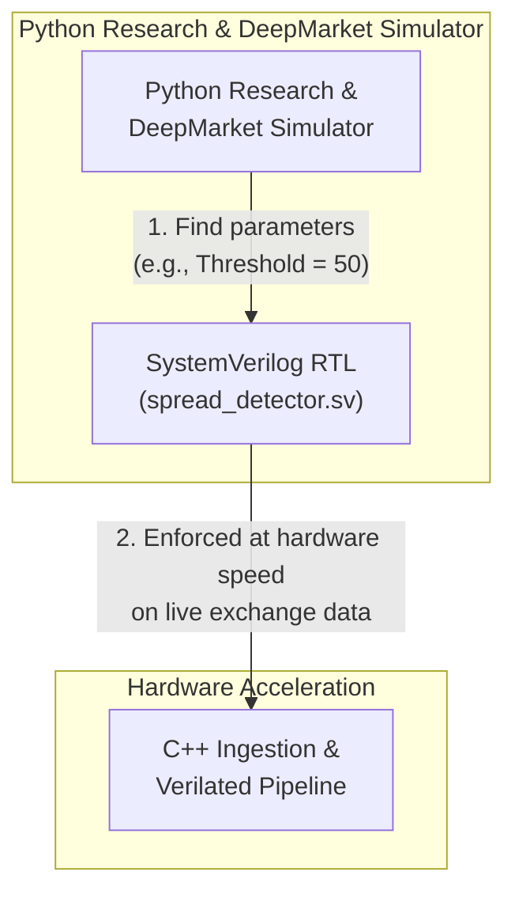
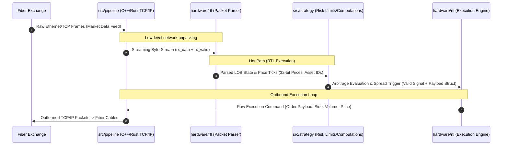

# Market Microstructure Ingestion Engine PoW
Author      : hmzk1422  
Version     : v1.0.0

## Architecture

Flow:  

Explanation for System Architecture:
- **Zero-Copy Ingestion (C++/Rust Network Layer)**: Replaces standard OS socket stacks with kernel-bypass polling (e.g., Solarflare EF_VI / DPDK) to ingest raw line-rate Ethernet frames directly into userspace memory buffers, eliminating context-switch jitter.
- **Deterministic FPGA Offload (SystemVerilog / Xilinx RTL)**: Pips raw order-book parsing and cross-exchange arbitrage threshold detection onto custom hardware. By avoiding CPU branch-misprediction penalties and cache misses, the RTL evaluates spreads in deterministic single-digit
- **Low-Latency Signal Interconnect (Verilated / Memory-Mapped I/O)**: Bridges the hardware detection trigger to the C++ orchestration layer via zero-copy shared memory rings and polled status registers (mmap), shaving microseconds off the standard Linux IPC overhead.
- **Asymmetric Risk & Execution Guardrails (Hot/Cold Split)**: The hot path executes bare-metal order construction upon signal assertion while offloading non-critical logging, telemetry, and TimescaleDB persistence to asynchronous background threads to guarantee zero blocking latency on the trading loop.

## Clearing House (Intermediary)
Explanation for System Architecture
- **Aggregation of Hybird Orderbook Data**: Queries from websocket directly, combines the aggregated liquidity in real markets as well as ABIDES-simulated data. Connects to Adversarial and User side by fiber cables.
- **Executional Friction and Liquidity System**: Manages FIFO queue for orders, slippage, priority orders between MARL agents, etc. Matches orders between MARL agents or real liquidity (Assumption: Liquidity is accurately simulated by using real data but lacks adaptive response from the market. As such, MARL agents handles this).
- **Data Modification**: Price data determined by real market or simulated market prices (Simulated market prices are constructed by synthetic features that explains only a portion of its variation (e.g., 50%)). However, new limit order/market order placements by player and MARL agents will cause drift in market price.

## Adversarial Side
Explanation for System Architecture
- **Toxic Order Flow Generation (Adversarial MARL / Momentum Ignition)**: Simulates predatory market participants and latency arbitrageurs designed to exploit information asymmetry, injecting toxic adverse selection and aggressive flow into the matching engine.
- **Dynamic Quote Stuffing & Spoofing Vectors**: Employs algorithmic agents that flood the limit order book with transient liquidity, phantom cancels, and high-frequency quote updates to stress-test the user's hardware spread detection and risk guardrails under adverse market conditions.
- **Adverse Selection & Queue Position Stress-Testing**: Probes the limits of the User Side's queue priority and fill probability models by simulating aggressive front-running and informed order cancellation cascades during high-volatility regimes.

# Core Commands/References
Run using WSL/Linux.
## C++ Pipeline & Hardware Build
```bash
# Clear old build artifacts and configure for Linux
rm -rf build
cmake -B build -DCMAKE_BUILD_TYPE=Release

# Build both the ingestion engine and Verilator hardware testbench
cmake --build build --parallel

# Run the standalone hardware simulation testbench
./build/hardware/sim/sim_spread_detector

# Run the live ingestion pipeline
./build/bybit_ingestion -c config.json
```
## Quantitative Simulator & Research (Python/ABIDES)
```bash
# Navigate to the simulator workspace
cd simulator/DeepMarket/ABIDES

# Run a clean independent crypto limit order simulation test
python config/crypto_limit_order_sim.py --qty 0.5

# Run with a larger event slice
python config/crypto_limit_order_sim.py --event-limit 1000000
```
## Docker Deployment
```bash
# Start via Docker Compose
cp .env.example .env
docker compose up -d --build --force-recreate ingestion

# View live execution logs
docker compose logs -f ingestion

# Stop containers
docker compose down
```
# Summary and Results
> NOTE: This system is instrumented for functional verification and architectural demonstration via Verilator in a virtualized WSL environment. Absolute latency metrics reflect software simulation and OS virtualization overhead, not bare-metal hardware performance.
# Citations
```
@article{berti2025trades,
  title={TRADES: Generating Realistic Market Simulations with Diffusion Models},
  author={Berti, Leonardo and Prenkaj, Bardh and Velardi, Paola},
  journal={arXiv preprint arXiv:2502.07071},
  year={2025}
}
```
