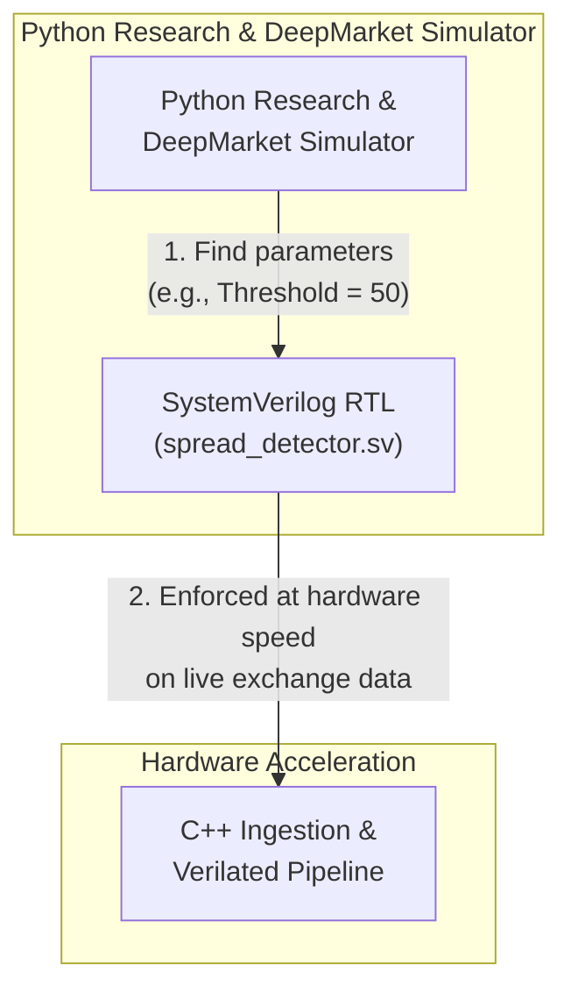
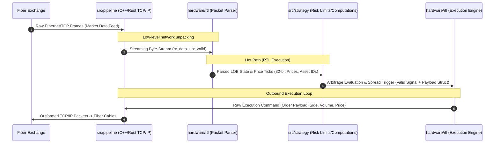

# Market Microstructure Ingestion Engine PoW
Professional-grade C++ pipeline for real-time Bybit WebSocket ingestion, coupled with a Verilated SystemVerilog hardware accelerator for ultra-low-latency spread detection, and a Python-based quantitative research simulator.

## Architecture

Flow:  

## Core Commands/References
Run using WSL/Linux.
### C++ Pipeline & Hardware Build
```bash
# Clear old build artifacts and configure for Linux
rm -rf build
cmake -B build -DCMAKE_BUILD_TYPE=Release

# Build both the ingestion engine and Verilator hardware testbench
cmake --build build --parallel

# Run the standalone hardware simulation testbench
./build/hardware/sim/sim_spread_detector

# Run the live ingestion pipeline
./build/bybit_ingestion -c config.json
```
### Quantitative Simulator & Research (Python/ABIDES)
```bash
# Navigate to the simulator workspace
cd simulator/DeepMarket/ABIDES

# Run a clean independent crypto limit order simulation test
python config/crypto_limit_order_sim.py --qty 0.5

# Run with a larger event slice
python config/crypto_limit_order_sim.py --event-limit 1000000
```
### Docker Deployment
```bash
# Start via Docker Compose
cp .env.example .env
docker compose up -d --build --force-recreate ingestion

# View live execution logs
docker compose logs -f ingestion

# Stop containers
docker compose down
```

# Citations
```
@article{berti2025trades,
  title={TRADES: Generating Realistic Market Simulations with Diffusion Models},
  author={Berti, Leonardo and Prenkaj, Bardh and Velardi, Paola},
  journal={arXiv preprint arXiv:2502.07071},
  year={2025}
}
```
