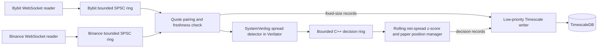

# Market Microstructure Ingestion Engine PoW
Author      : hmzk1422  
Version     : v1.0.0

> **Current scope:** This repository is a Verilator based paper trading and market data prototype. Historical latency figures below are from a prior run and are not a current performance guarantee. It does not send exchange orders or use a physical FPGA, DMA device, kernel bypass network stack, or fiber link.
> 
> * **Performance & Telemetry:** Read the full breakdown in **[BENCHMARK.md](./BENCHMARK.md)**.
> * **Hardware Roadmap:** Moving to physical Xilinx target (changes to the code) **[FPGA_PERFORMANCE_PLAN.md](./FPGA_PERFORMANCE_PLAN.md)**.
## Implemented Architecture



The default ABIDES input is a single simulated book mirrored to both venue
inputs. Use the deterministic `synthetic` source for repeatable positive and
negative spread scenarios across many symbols. WebSocket mode consumes public
quotes. All three modes feed the same Verilated RTL and C++ paper strategy.

| Component | Implemented behavior | Not represented by this repository |
|---|---|---|
| Market data | Public Bybit and Binance best bid/ask streams; ABIDES and deterministic synthetic sources | Raw Ethernet ingress, synchronized venue clocks |
| RTL | Synthesizable fixed-point cross-venue fee/spread candidate detector and decision acknowledgement, exercised through Verilator | A deployed FPGA, physical clock rate, place-and-route timing |
| C++ strategy | Recomputes net spread from copied prices, applies a per-symbol 50-sample z-score gate, and returns simulated execute/quantity decisions to RTL | Exchange order submission, guaranteed real fills, queue position |
| Transport | Named OS shared-memory ring for copied quote/RTL records plus bounded lock-free response queues | PCIe, device DMA, kernel bypass |
| Telemetry | Asynchronous TimescaleDB price, decision, resource, latency, trade-count, and realized-PnL records | One-way network latency without clock synchronization |

### Planned extensions

A physical FPGA can replace the Verilator boundary when a board and device
interface are available. The named shared-memory ring is a mapped-memory
software surrogate; it does not claim PCIe or hardware DMA. Real order
execution requires venue-specific order-entry, acknowledgement, partial-fill,
cancel, risk-limit, and reconciliation handling. The app can pin its market and
strategy threads; kernel CPU isolation remains a host configuration task.
# Run in WSL (ABIDES or exchange WebSockets)

The source-selectable application is `hardware/build/market_data_engine`. It
uses the SystemVerilog spread detector through Verilator. Sources are `abides`,
`websocket`, and deterministic `synthetic`.

## Build

**Use WSL/Debian Ubuntu.**
Run these commands from WSL in the repository root. WSL needs CMake, a C++20
compiler, Verilator, Boost.Beast headers, nlohmann-json, OpenSSL development
libraries, and PostgreSQL client development headers/libraries. The container
build installs these dependencies.

```bash
cmake -S hardware -B hardware/build -DCMAKE_BUILD_TYPE=Release
cmake --build hardware/build --parallel 2
ctest --test-dir hardware/build --output-on-failure
```

## ABIDES source (default)

Use two WSL terminals, both in the repository root. Start the simulator first:

```bash
python3 -u exchange/abides/exchange_simulator.py \
  --socket /tmp/market_simulator.sock --symbols BTCUSDT ETHUSDT
```

Then run the application in the second terminal:

```bash
./hardware/build/market_data_engine --source abides --symbols BTCUSDT,ETHUSDT
```

## Public Bybit and Binance WebSockets

No simulator process is needed. Run from the repository root:

```bash
./hardware/build/market_data_engine \
  --source websocket --symbols BTCUSDT,ETHUSDT
```

The application subscribes to Bybit linear ticker and Binance book-ticker
streams for each configured symbol. Use `Ctrl+C` to stop. It writes terminal
output to `market_data_engine.txt` in the current directory. The log includes
the first ten RTL inputs, periodic status, and paper trade entries/exits.
`--verbose` prints every processed RTL input and Verilator arbitrage alerts.

Both venues must have a fresh, complete quote before a symbol is sent to RTL.
The RTL compares both executable buy/sell directions after the configured fees.
The paper strategy assumes zero fees by default to show gross spread signals;
set `--bybit-fee-bps` and `--binance-fee-bps` to your account's fees for net
signals. `--paper-slippage-bps` affects paper PnL only; the RTL candidate screen
does not estimate slippage or available quantity. The RTL first emits
fee-adjusted profitable spread candidates. C++ then
computes a rolling z-score from that same net cross-venue spread and only enters
a paper position after 50 prior observations when it meets
`--zscore-threshold` (default `2.0`). Options `--min-profit`,
`--max-quote-age-ms`, and `--zscore-threshold` configure these gates.
The executable reports paper trades only and does not send orders. ABIDES supplies one simulated book,
which is mirrored to the two RTL venue inputs for exercising the pipeline; it
does not represent two independent venues or demonstrate arbitrage.

Data flow is WebSocket readers → bounded per-venue lock-free rings holding
fixed-size quote records → Verilated RTL spread/fee screen → named mapped-memory
ring carrying prices and the RTL candidate → C++ recomputation and z-score → a
bounded response ring → Verilated RTL execution acknowledgement and quantity.
The mapping is a software DMA stand-in, not a device interface. Strategy
handoffs and telemetry records are preallocated; JSON decoding and network I/O
stay on feed threads. On queue overflow, the incoming item is dropped and counted. The async,
lower-priority TimescaleDB writer receives fixed-size in-memory records; it
persists `market_prices`, per-message `latency_samples`, `strategy_decisions`,
and one-second `runtime_metrics` samples without making database calls from the
market loop. Set
`TIMESCALE_CONN` to configure it. For a local WSL run with the bundled database,
start it with `docker compose up -d timescaledb` and set
`TIMESCALE_CONN='host=localhost port=5433 dbname=market_data user=market password=market'`.
The metrics include process and system CPU, process and system RAM, p50/p95/p99
and maximum RTL-to-C++-to-RTL acknowledgement latency, modeled route p50/p99 by
firm location, WebSocket interarrival-jitter proxy, paper trade count, and
cumulative realized paper PnL. Price rows also store exchange event time and event age;
because exchange and local clocks can differ, event age is not a one-way
network latency measurement. Queue overflow and database write failures are
counted, and unavailable samples are stored as NULL. Latency percentiles use a
fixed histogram (1 μs buckets below 1 ms and 1 ms buckets below 1 s). Use
`--latency-every-message` to print each paired quote's software round trip and
the three modeled route totals. Per-message printing adds load, so use it to
inspect individual transactions; use the histogram for performance runs.
`[SYSTEM]` prints CPU, RAM, and latency summaries once per second. `--market-cpu N`
and `--strategy-cpu N` pin those threads where the OS allows it; `isolcpus`
remains a host boot setting.

The executable supports up to 65,534 configured symbol IDs, but that limit is
an interface bound, not evidence of tested throughput at hundreds of assets.
Run a deterministic 512-symbol pipeline load without exchange or database
access with:

```bash
symbols=$(python3 -c 'print(",".join(f"ASSET{i:04d}" for i in range(512)))')
./hardware/build/market_data_engine --source synthetic --symbols "$symbols" \
  --duration-sec 3 --synthetic-tick-ms 10 --no-telemetry
```

The fixture alternates narrow and wide positive spreads; it measures the
software simulation pipeline, not real venue performance or profitability.

### Colocation and network scenario

The selected comparison is a firm in Singapore, a firm in Tokyo, and a firm at
their geographic midpoint. The propagation estimate uses city coordinates, a
1.468 fiber refractive index, and a 1.35 assumed route stretch. Noise combines
a mean-reverting OU-style process with rare positive Pareto spikes. Its OU scale
uses an EWMA absolute deviation of observed WebSocket message interarrival
times (OU mean 50 μs, per-event reversion 0.08; shock sigma is 25% of that
proxy). Pareto spikes use probability 0.001, shape 2.5, and a scale of at least
50 μs. Interarrival variation is a jitter proxy, not direct one-way network
latency. The model adds software round-trip time and the slower exchange-leg
RTT; it does not inject delays into the measured software round trip.
`--network-seed` makes runs reproducible.

For a small live display of every software round trip and the modeled location
totals, run:

```bash
./hardware/build/market_data_engine --source synthetic --symbols BTCUSDT \
  --duration-sec 1 --synthetic-tick-ms 100 --no-telemetry \
  --latency-every-message --network-seed 42
```

Bybit's help material describes its API servers as running in AWS Singapore.
The Tokyo Binance endpoint is a scenario assumption: a Tokyo corporate office
does not establish where an API gateway or matching engine runs. Treat both
endpoint coordinates as assumptions until verified with measured routes or
provider disclosures. See [Bybit's connection guidance](https://www.bybit.com/en/help-center/article/How-to-Optimize-Trading-Experience?category=0ba248783af2b745a6).
The simulation compares geographic propagation; it does not model order-book
competition, liquidity, or market-maker response.

## RTL interface and verification

The detector samples inputs on the rising edge of `clk`; `rst_n` is an
asynchronous active-low reset. `input_ready` is always asserted. A valid input
requires both `input_valid` and `quotes_valid`, nonzero prices, and fees no
greater than 10,000 bps. Prices are unsigned 32-bit values scaled by 10,000;
fees are unsigned 16-bit basis points; `min_profit_i` is unsigned 49-bit in
price-times-10,000 units. The registered outputs have one rising-edge
input-to-output latency: `candidate_valid_o`, 2-bit direction, signed 49-bit
net profit, 16-bit symbol ID, and 32-bit transaction ID. A candidate is emitted
only when net profit is positive and strictly greater than `min_profit_i`.
Invalid inputs clear the candidate output. Valid-range arithmetic is covered
by boundary tests; invalid fees and zero prices are rejected.
After C++ evaluates the copied quote record, it returns execute/reject,
quantity, and transaction ID. RTL acknowledges the response on the next rising
edge. The measured software round trip starts just before C++ handoff and ends
when that matching RTL acknowledgement is observed. It includes C++ queueing,
strategy computation, response queueing, and the Verilator handshake; it excludes
WebSocket transport and exchange order I/O.

The test suite includes the RTL reference model and decision acknowledgement,
strategy warm-up, zero-variance, rolling-eviction, risk-gate, memory-mapped ring
ordering, deterministic 512-symbol histories, and network-model route/noise
checks. When Verilator is installed, the RTL test also produces a VCD waveform:

```bash
ctest --test-dir hardware/build --output-on-failure
```

The waveform is `hardware/build/spread_detector.vcd` and includes clock, reset,
input, candidate, and C++ decision acknowledgement signals. The RTL test covers
reset, both directions, threshold equality, arithmetic limits, invalid inputs,
consecutive inputs, and execute/reject/quantity return behavior.

`hardware/rtl/synth.ys` is a generic Yosys flow. This repository does not include
verified device-specific resource utilization, place-and-route timing closure,
or a bitstream. Do not treat generic Yosys cell counts as FPGA resources.
# Summary and Results
> NOTE: This system is instrumented for functional verification and architectural demonstration via Verilator in a virtualized WSL environment. Absolute latency metrics reflect software simulation and OS virtualization overhead, not bare-metal hardware performance.
# Citations
```
@article{berti2025trades,
  title={TRADES: Generating Realistic Market Simulations with Diffusion Models},
  author={Berti, Leonardo and Prenkaj, Bardh and Velardi, Paola},
  journal={arXiv preprint arXiv:2502.07071},
  year={2025}
}
```
